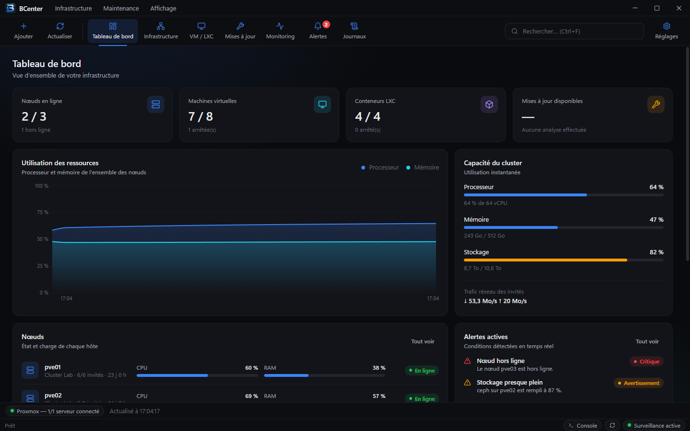

<p align="center">
  
</p>

<h1 align="center">BCenter</h1>

<p align="center">
  Windows desktop app to monitor and maintain your Proxmox VE infrastructure.
</p>

<p align="center">
  <a href="https://github.com/bretazaaa/BCenter/releases/latest"></a>
  <a href="https://github.com/bretazaaa/BCenter/actions/workflows/ci.yml"></a>
  <a href="LICENSE"></a>
</p>



> The user interface is currently available in French.

## Features

- **Dashboard** – nodes, VMs, LXC containers, cluster capacity, alerts and recent activity at a glance.
- **Infrastructure** – servers, nodes and storages with live usage.
- **VM / LXC** – filter guests and start, shut down, reboot or stop them.
- **Update center** – scan and apply package updates on your machines over SSH (apt, dnf, yum, apk, zypper, pacman), one by one or in bulk, with a live execution log.
- **Safe updates** – a Proxmox snapshot is taken before each update, can be restored in one click, and is pruned automatically after a configurable retention period. Your scheduled backups (NAS, Proxmox Backup Server) stay managed by Proxmox.
- **Monitoring** – CPU, memory, network and load history from Proxmox RRD data.
- **Alerts** – unreachable servers, offline nodes, CPU / memory / storage thresholds, pending reboots, with Windows notifications.
- **Runs in the background** – closing the window keeps BCenter in the notification area; monitoring and running tasks continue.
- **Automatic updates** – new versions are downloaded from GitHub Releases and installed when you choose.

## Installation

1. Download `BCenter-Setup-x.y.z.exe` from the [latest release](https://github.com/bretazaaa/BCenter/releases/latest).
2. Run the installer. No administrator rights are required.

The installer is not code-signed yet: Windows SmartScreen may show a warning. Choose **More info › Run anyway**.

Requirements: Windows 10 (1809) or Windows 11, 64-bit.

## Getting started

A setup wizard runs on first launch. You will need:

**A Proxmox VE API token.** On a Proxmox node:

```bash
pveum user add bcenter@pve
pveum role add BCenterOps -privs "Sys.Audit VM.Audit Datastore.Audit VM.Snapshot VM.Snapshot.Rollback VM.PowerMgmt VM.Monitor"
pveum aclmod / -user bcenter@pve -role BCenterOps
pveum user token add bcenter@pve bcenter --privsep 0
```

Use `bcenter@pve!bcenter` as the token ID and the secret printed by the last command. If your Proxmox version rejects `VM.Monitor`, remove it: only guest IP discovery through the QEMU agent will be unavailable.

**SSH access to the machines you want to update** (optional, can be configured later): a private key (recommended) or a password. Non-root users need passwordless `sudo` for the package manager.

**Try it without Proxmox:** start BCenter with `--demo` to explore the interface with a simulated cluster. Demo data is kept separately from your real configuration.

## Security

- API tokens, SSH passwords and key passphrases are encrypted with Windows DPAPI and bound to your Windows account. Only encrypted data is stored on disk; secrets are never logged.
- TLS certificates must be trusted by Windows, or their SHA-256 fingerprint must be approved explicitly (Proxmox self-signed certificates).
- SSH host keys are verified against an approved SHA-256 fingerprint; a changed key blocks the connection.
- Local data (SQLite database, logs) lives in `%LOCALAPPDATA%\BCenter`.

## Development

Requirements: Node.js 24 and npm.

```bash
npm install
npm run dev        # start the app with hot reload
npm test           # unit tests
npm run typecheck  # TypeScript checks
npm run dist       # build the Windows installer into dist/
```

Stack: Electron, React, Vite, Zustand, TypeScript, Recharts, ssh2, SQLite (`node:sqlite`), electron-builder and electron-updater.

```
src/
├─ main/       Electron main process: engine, Proxmox client, SSH, storage, tray, updates
├─ preload/    Isolated bridge between the UI and the engine
├─ renderer/   React interface
└─ shared/     Types and API contract shared by both sides
```

Other virtualization platforms can be added by implementing the `VirtualizationProvider` interface (`src/main/services/provider.ts`).

## Releasing

1. Bump the version: `npm version patch` (or `minor` / `major`). This creates a commit and a `vX.Y.Z` tag.
2. Push: `git push --follow-tags`.

The [Release workflow](.github/workflows/release.yml) builds the installer and publishes it to GitHub Releases. Installed copies of BCenter detect the new version automatically.

## License

[MIT](LICENSE)
