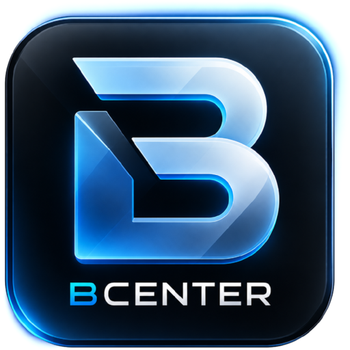

<p align="center">
  
</p>

<h1 align="center">BCenter</h1>

<p align="center"><b>Monitor and maintain your Proxmox VE infrastructure and NAS from a Windows desktop app.</b></p>

<p align="center">
  <a href="https://github.com/bretazaaa/BCenter/releases/latest"></a>
  <a href="https://github.com/bretazaaa/BCenter/releases"></a>
  <a href="LICENSE"></a>
</p>

---

## Download

Grab the latest **[BCenter-Setup.exe](https://github.com/bretazaaa/BCenter/releases/latest)** from the releases page.

- **Windows 10 (1809) / 11, 64-bit** — no administrator rights required.
- **Auto-updates:** BCenter checks this repository's releases and updates itself — install once, stay current.
- The installer is not code-signed yet: if Windows SmartScreen shows a warning, choose **More info › Run anyway**.

## What is BCenter?

BCenter is a desktop control center for Proxmox VE and NAS systems:

- **Dashboard** — nodes, VMs, LXC containers, NAS, cluster capacity, alerts and recent activity at a glance.
- **Infrastructure** — servers, nodes and storages with live usage.
- **VM / LXC** — filter guests, start, shut down, reboot or stop them.
- **NAS** — TrueNAS (SCALE / CORE), Synology DSM, Unraid, OpenMediaVault, QNAP (basic) and Proxmox Backup Server: pools and volumes, disk health and temperature, shares, services, apps and containers, data tasks and alerts. Act directly from BCenter: start / stop services and apps, run snapshot, replication, sync and backup tasks, scrub, update, reboot.
- **SSH shell** — built-in terminal on your machines, guests and NAS.
- **Update center** — scan and apply package updates over SSH (apt, dnf, yum, apk, zypper, pacman), one by one or in bulk, with a live execution log.
- **Safe updates** — a Proxmox snapshot is taken before each update, restorable in one click and pruned automatically after a configurable retention period. Your scheduled backups (NAS, Proxmox Backup Server) stay managed by Proxmox.
- **Monitoring** — CPU, memory, network and load history for nodes, guests and NAS.
- **Alerts** — unreachable servers or NAS, offline nodes, degraded pools, failing disks, CPU / memory / storage thresholds, pending reboots, with Windows notifications.
- **Runs in the background** — closing the window keeps BCenter in the notification area; monitoring and running tasks continue.

The interface is currently available in French.

## Getting started

A setup wizard runs on first launch. You will need a **Proxmox VE API token**. On a Proxmox node:

```bash
pveum user add bcenter@pve
pveum role add BCenterOps -privs "Sys.Audit VM.Audit Datastore.Audit VM.Snapshot VM.Snapshot.Rollback VM.PowerMgmt VM.Monitor"
pveum aclmod / -user bcenter@pve -role BCenterOps
pveum user token add bcenter@pve bcenter --privsep 0
```

Use `bcenter@pve!bcenter` as the token ID and the secret printed by the last command. If your Proxmox version rejects `VM.Monitor`, remove it: only guest IP discovery through the QEMU agent will be unavailable.

To update your machines, BCenter also needs **SSH access** (private key recommended; non-root users need passwordless `sudo` for the package manager). This can be configured later.

NAS systems are added from **Add › NAS** with an API key (TrueNAS, Unraid), an API token (Proxmox Backup Server) or an administrator account (Synology, OpenMediaVault, QNAP); the dialog explains where to create it.

Want to look around first? Start BCenter with `--demo` to explore the interface with a simulated cluster and NAS.

## Security

- API tokens, NAS credentials, SSH passwords and key passphrases are encrypted with Windows DPAPI, bound to your Windows account, and never logged.
- TLS certificates must be trusted by Windows or explicitly approved by their SHA-256 fingerprint.
- SSH host keys are verified against an approved fingerprint; a changed key blocks the connection.
- Everything stays on your PC (`%LOCALAPPDATA%\BCenter`). BCenter only talks to your own servers and to GitHub for updates.

Found a security issue? Please report it privately through [GitHub security advisories](https://github.com/bretazaaa/BCenter/security/advisories/new) rather than a public issue.

## Building from source

Requirements: Windows, Node.js 24 and npm.

```bash
npm install
npm run dev        # start the app with hot reload (add -- -- --demo for a simulated cluster and NAS)
npm test           # unit tests
npm run typecheck  # TypeScript checks
npm run dist       # build the Windows installer into dist/
```

Stack: Electron, React, Vite, Zustand, TypeScript, Recharts, ssh2, ws, SQLite (`node:sqlite`), electron-builder and electron-updater.

```
src/
├─ main/       Electron main process: engine, Proxmox client, NAS drivers, SSH, storage, tray, updates
├─ preload/    Isolated bridge between the UI and the engine
├─ renderer/   React interface
└─ shared/     Types and API contract shared by both sides
```

- Other virtualization platforms can be added by implementing `VirtualizationProvider` (`src/main/services/provider.ts`).
- NAS platforms are drivers implementing `NasDriver` (`src/main/nas/driver.ts`), registered in `src/main/nas/index.ts`.

## Contributing

Bug reports, ideas and pull requests are welcome.

- **Issues:** [open an issue](https://github.com/bretazaaa/BCenter/issues) with your BCenter version and, when relevant, the log files (Settings › Local data, `logs` folder). For NAS problems, include the NAS system and its version.
- **Pull requests:** keep them focused, and make sure `npm run typecheck` and `npm test` pass (CI runs both).

## Releasing (maintainers)

1. Write the release notes in `release-notes/vX.Y.Z.md`.
2. `npm version patch` (or `minor` / `major`) — creates a commit and a `vX.Y.Z` tag.
3. `git push --follow-tags`.

The [Release workflow](.github/workflows/release.yml) runs the checks, builds the installer and publishes it to this repository's Releases, where installed copies of BCenter pick it up automatically.

## License

BCenter is free software, released under the [GNU General Public License v3.0](LICENSE).
Copyright © 2026 Bretaza.
